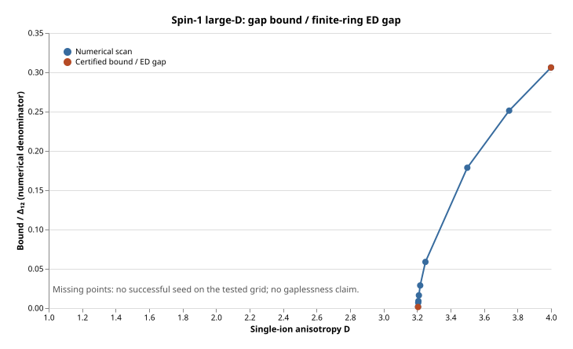

# Spin-one large-D spectral-gap certificate

Model: H = Σ Sⱼ·Sⱼ₊₁ + D Σ (Sᶻⱼ)² on periodic rings, with one site per cell.

**Smallest certified sampled D: 1603//500 = 3.206.** This is a finite-size, finite-grid search threshold, not a proven minimum over all real D or a phase boundary. At that D the uniform bound is **0.002213456**, for **every even L ≥ 6 cells = sites**.

## Certified results

| D (exact) | n₀ | β₀ (exact) | Uniform lower bound | ED gap at 2n₀ | Bound / ED gap |
|---|---:|---|---:|---:|---:|
| 1603//500 | 6 | 381//125 | 0.002213456 | 1.5453282 | 0.00143235391 |
| 4//1 | 6 | 9//4 | 0.694694192 | 2.26945894 | 0.306105645 |

Displayed certified lower bounds are rounded down to nine decimal places; the full binary endpoints are stored in JSON. The ED reference is the computed finite-ring L=12 gap. Its use as a thermodynamic reference, and the plotted ratios, are numerical. Exact rational defect bounds are in `results/certificate_D*.json`; each certificate hashes its source and full enclosed spectra.

## Reflection positivity and rigorous method

In the Cartesian basis, Gₓ=[0 0 0;0 0 1;0 -1 0], Gᵧ=[0 0 -1;0 0 0;1 0 0], G_z=[0 1 0;-1 0 0;0 0 0]. The exact identity is −h=Σₐ Gₐ⊗Gₐ, with all coefficients exactly 1, and the onsite term D diag(1,1,0) is real symmetric. The checker independently verifies h=P−|Ω⟩⟨Ω| and the spin commutator and Casimir.

Every certification sector is diagonalized densely. Interval block construction bounds matrix error; computed residuals AQ−QΛ and Q*Q−I are enlarged by rigorous BLAS roundoff norm bounds. For residual bound r, orthogonality bound e<1, matrix error c and norm bound M, the polar/Weyl theorem gives eigenvalue radius

    η = c + r + (M + ‖Λ‖₂) e / (1 + sqrt(1−e)).

[METHOD.md](METHOD.md) proves this theorem and specifies the floating-point assumptions. Outward-rounded log-partition intervals yield exact rational upper defect bounds; the unmodified `certified_gap_bound` then supplies the reported lower bound. The uniform conclusion invokes the repository's stated two-purity theorem.

## Search and numerical results

The quarter-step grid covers D=1:0.25:4, with additional sampled D near the first successful interval. β=0.125:0.125:20, n₀=2,…,6; selected near-threshold samples additionally use β=2.75:0.002:3.75 at n₀=6. The table uses the best available grid at each D. Only even n₀ enter `best_seed`; the scope note explicitly requires even n₀. Odd n₀ are diagnostics. The search uses Sz, translation, charge inversion, spin-inversion parity at Sz=0, and conjugate momentum pairing. Partial Krylov spectra are permitted only for numerical screening; their tails use the same cutoff bookkeeping as the core. No partial spectrum is used in a certificate.

The bound uses the core's asymmetric two-defect recurrence. It can enter the admissible square after several iterations even when the initial spatial defect exceeds 0.12731; that number is an equal-defect sufficient condition, not a necessary cutoff. Thus a successful asymmetric seed can have min(Pₛ,Pτ) below 0.87269. The certificates record the first admissible iteration.

| D | Best n₀ | Best β₀ | Numerical bound | Δ₁₂ | Scan seconds |
|---:|---:|---:|---:|---:|---:|
| 1.0 | — | — | no seed | 0.255422845 | 24.9310567 |
| 1.25 | — | — | no seed | 0.280374097 | 23.5145152 |
| 1.5 | — | — | no seed | 0.341844178 | 23.7054131 |
| 1.75 | — | — | no seed | 0.443838569 | 28.6881824 |
| 2.0 | — | — | no seed | 0.58396634 | 23.1444359 |
| 2.25 | — | — | no seed | 0.754129778 | 24.0350962 |
| 2.5 | — | — | no seed | 0.945181992 | 24.5134413 |
| 2.75 | — | — | no seed | 1.15003728 | 24.7441518 |
| 3.0 | — | — | no seed | 1.36408291 | 24.0545282 |
| 3.125 | — | — | no seed | 1.47362087 | 22.5243311 |
| 3.15625 | — | — | no seed | 1.50122241 | 27.2583005 |
| 3.1875 | — | — | no seed | 1.5289041 | 20.2016323 |
| 3.203125 | — | — | no seed | 1.54277406 | 21.4271014 |
| 3.204 | — | — | no seed | 1.54355134 | 25.9776247 |
| 3.205 | — | — | no seed | 1.54443973 | 23.6739757 |
| 3.206 | 6 | 3.048 | 0.002825968 | 1.5453282 | 24.902127 |
| 3.207 | 6 | 3.046 | 0.0108151912 | 1.54621675 | 24.4718201 |
| 3.208 | 6 | 3 | 0.0140035063 | 1.54710537 | 23.7714889 |
| 3.2109375 | 6 | 3 | 0.0251996298 | 1.54971615 | 23.3168106 |
| 3.21875 | 6 | 3.02 | 0.0449117107 | 1.55666294 | 23.5639019 |
| 3.25 | 6 | 3 | 0.0931407916 | 1.58449608 | 23.5698628 |
| 3.5 | 6 | 2.625 | 0.323249924 | 1.80954209 | 23.9589891 |
| 3.75 | 6 | 2.375 | 0.512077138 | 2.03811207 | 23.3456101 |
| 4.0 | 6 | 2.25 | 0.694754816 | 2.26945894 | 26.1018531 |

At the original D=4 survey seed β=3, this numerical rerun gives 0.543863733, differing from the supplied 0.543842 by about 0.0000217. The quoted survey value is not used as a certificate input; full dense enclosures are computed independently. The optimized D=4 seed uses β=2.25. The curve and its machine-readable data are in `results/curve.svg`, `curve.csv`, and `curve.json`. Missing values mean that the tested grid did not yield a seed, not that the physical gap vanishes.

## Sizes, sectors, and runtimes

Numerical rings: L=2,3,4,5,6,8,10,12. Certified spectra: L=6 and 12 at the two stated D values. At L=12 the product dimension is 3¹²=531441. Complete sector-by-sector dimensions, multiplicities, residual bounds and times are stored in each `enclosed_*.json`. Each run asserts their weighted sum is 3^L.

| D | L | Computed blocks | Largest block | Weighted dimension | Max radius | Seconds |
|---|---:|---:|---:|---:|---:|---:|
| 1603//500 | 6 | 29 | 21 | 729 | 3.15595463e-11 | 0.0983731747 |
| 1603//500 | 12 | 92 | 5798 | 531441 | 3.50210262e-06 | 2116.96228 |
| 4//1 | 6 | 29 | 21 | 729 | 3.69190057e-11 | 0.154829025 |
| 4//1 | 12 | 92 | 5798 | 531441 | 4.06622788e-06 | 2164.14462 |

L=14 was not attempted densely: the nonzero-charge momentum blocks have 41835 states at Sz=1, making a complex matrix alone 28.003 GB before eigenvectors and workspaces, above this host's 16 GiB memory limit. Also n₀=7 is odd and cannot directly invoke the stated moment theorem. Longer even seeds would require L≥16.

## Negative-grid diagnostics and extrapolation

All values below are numerical. For each D without a successful even seed, the table lists max over β of min(Pₛ,Pτ), plus δ(n)=E₀(2n)−2E₀(n). Odd n₀ diagnostics are present in the JSON summaries but do not meet the theorem.

| D | max min purity, n=2 | n=4 | n=6 | δ(2) | δ(4) | δ(6) | Extrapolated (n,β) |
|---:|---:|---:|---:|---:|---:|---:|---:|
| 1.0 | 0.205256369 | 0.308992758 | 0.335417058 | 1.85989093 | 0.584461445 | 0.35280709 | (26, 29.9116673) |
| 1.25 | 0.212930876 | 0.326382564 | 0.348645363 | 1.79922484 | 0.564460942 | 0.343923209 | (26, 27.2497469) |
| 1.5 | 0.221713577 | 0.344176598 | 0.374989284 | 1.73486812 | 0.539731879 | 0.322854396 | (24, 22.1155747) |
| 1.75 | 0.231425092 | 0.364320307 | 0.423051144 | 1.66812965 | 0.50683136 | 0.287635365 | (22, 16.8373585) |
| 2.0 | 0.247750223 | 0.408967226 | 0.493586975 | 1.5997626 | 0.465196011 | 0.242188364 | (18, 12.4534548) |
| 2.25 | 0.275196096 | 0.451450585 | 0.57200244 | 1.53041155 | 0.417269598 | 0.194237837 | (16, 9.48724685) |
| 2.5 | 0.306920957 | 0.501106186 | 0.65500313 | 1.46082768 | 0.367033003 | 0.150463832 | (14, 7.42828791) |
| 2.75 | 0.330620383 | 0.564477002 | 0.732946333 | 1.39187155 | 0.318222243 | 0.114144413 | (12, 5.97105277) |
| 3.0 | 0.343698363 | 0.608181722 | 0.79940225 | 1.32440829 | 0.273360667 | 0.0857331556 | (10, 4.90044387) |
| 3.125 | 0.350445406 | 0.645092515 | 0.824461475 | 1.29147958 | 0.252836148 | 0.0742104595 | (10, 4.53618149) |
| 3.15625 | 0.352152537 | 0.653865627 | 0.830312932 | 1.28334524 | 0.247916893 | 0.0715805707 | (10, 4.45277906) |
| 3.1875 | 0.353867556 | 0.659050085 | 0.835998449 | 1.27525234 | 0.243083337 | 0.0690452944 | (10, 4.37215893) |
| 3.203125 | 0.354727982 | 0.661634215 | 0.838779151 | 1.27122177 | 0.240698754 | 0.0678122407 | (10, 4.33285204) |
| 3.204 | 0.354776222 | 0.661778754 | 0.838933651 | 1.27099637 | 0.240565852 | 0.0677438607 | (10, 4.33067016) |
| 3.205 | 0.354831362 | 0.661943919 | 0.839110063 | 1.27073882 | 0.240414047 | 0.0676657987 | (10, 4.32817908) |

Extrapolation fits δ(n)=δ(6) exp[−(n−6)/ξδ] using n=4,6 only, with ξδ=−2/log(δ(6)/δ(4)). It holds the L=12 gap fixed and sets β=log(80n)/Δ₁₂, then selects the first even n with βδ(n)<0.075. This corresponds to the crude low-temperature estimates εₛ≈βδ(n)+2n exp(−βΔ₁₂)<0.1 and ετ≈4n exp(−βΔ₁₂)=0.05. It is an illustrative size estimate, not an enclosure, and may be poor near criticality. No extrapolated seed was certified.

## Historical provenance and current-core replay

The dense computations and original 123-check replay used core revision `ef0a3e6cf54ec56dcef5e8a37963d0184f6fd31b` (`ThermalMPOGap`). Upstream then renamed the package to `CertifiedGaps` at `22b2759e0790197b83e2571b465aa8dc69ebc0be`. Original source files are preserved byte for byte in `provenance/legacy/`; no historical source or core hashes were rewritten. Current executable imports were migrated only within this certificate directory.

The current checker verifies that the model, seed assembler and dense drivers differ from their archived versions only by the package identifier. It verifies historical core hashes against immutable Git objects, requires the current recurrence implementation to be byte-identical, and replays the partition intervals and rational bounds with the renamed core. The separate record is `results/validation-current.json`; logs are `fast-tests.log` and `fast-tests-legacy.log`. `check_pinned.jl` additionally replays the original checker with the exact old core in a temporary workspace. These are replay and migration checks, not a second full L=12 ED computation. The explicit user-requested `certificates/spin1_largeD/` location is retained.

## Verification and limitations

- **Certified:** exact RP identity, complete sector counting, dense spectrum enclosures and rational seeds for the two reported parameters, and the recurrence lower bounds under the repository's theorem.
- **Numerical, not certified:** all search rows, the ED reference gaps/ratios, the curve between certified points, nonexistence of seeds at unsuccessful grid points, and all size extrapolations.
- No proof is claimed that all smaller real D fail, that no other β succeeds, or that a larger even seed cannot work.
- `test/small.jl`: independent full dense comparisons through L=6 and enclosure checks through L=4; 20 checks passed.
- `test/symmetry.jl`: exact transition covariance under translation and spin inversion, charge conservation through L=6, and orbit-dimension counts through L=12; 3278 checks passed in 4.8 seconds.
- `test/runtests.jl`: exact RP, source/data hashes, multiplicity accounting, partition interval reconstruction, and recurrence from stored rational seeds. See `results/fast-tests.log` for the actual final test count and timing.
- Julia 1.12.4, IntervalArithmetic 1.0.12, one BLAS thread. Runtime/dependency details are in README.md and result metadata. All project changes stay inside this directory; no core or CI changes and no merge were performed.

