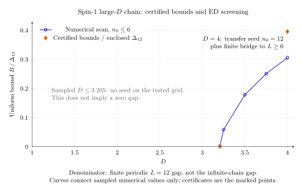

# Spin-1 large-D uniform-gap certificates

H = Σⱼ Sⱼ·Sⱼ₊₁ + D Σⱼ(Sᶻⱼ)² on periodic rings, with one site per cell.
All lengths below count **sites**. The conclusions use the repository's two-purity theorem.

| D | Certified gap lower bound | Validity | Seed (n₀, β₀) |
|---|---:|---|---|
| 4 | **0.899143399** | every even L ≥ 6 | (12, 29/10), with a finite bridge at L = 6, 8, 10 |
| 16029999/5000000 = **3.2059998** | **0.001001626** | every even L ≥ 6 | (6, 381/125) |

Both conclusions include a unique ground state. Displayed bounds are rounded **down**.
The second bound holds throughout **D ∈ [3.2059998, 3.206]**. This is the smallest D
certified by this search, not a proven global minimum over real D or over all possible seeds.

Exact defect upper bounds:

| Seed | εₛ | εₜ |
|---|---|---|
| D = 4, n₀ = 12 | 8376656523711495 / 2305843009213693952 | 283096258190373 / 9007199254740992 |
| D ∈ [3.2059998, 3.206], n₀ = 6 | 863115144109137 / 4503599627370496 | 418622220052377 / 9007199254740992 |

The new [certificate.json](certificate.json) contains exact rational strings, four log Z
intervals per case, source/input SHA-256 hashes, and Julia/package versions. It also records
successful larger seeds through n₀ = 96 at D = 4. The original point certificates remain
unchanged in `results/certificate_D*.json`.

## Beyond exact diagonalization

The largest spectral input is L = 12. Transfer-operator squaring and the exact coupling
identity bound Pₛ(12,β) and Pτ(24,β) **without diagonalizing L = 24**. This improves the D = 4
bound from the reproduced ED-seed bound 0.694694192 to 0.899143399. Fresh verified spectra
at L = 8 and 10, plus the stored L = 6 spectrum, extend the stronger conclusion down to L = 6.
[TRANSFER.md](TRANSFER.md) proves the lift, centered Weyl transport in D, and tail bounds.
[IDEAS.md](IDEAS.md) records the route comparison, committed before the new calculations.

The original survey seed (D,n₀,β₀) = (4,6,3) is independently propagated from verified
spectra: **gap ≥ 0.543812926**. The supplied floating-point 0.543842 is not used as a premise
and is not certified by these conservative enclosures.

## Search and curve

The fresh numerical scan covers D = 1:0.25:4, even n₀ = 2,4,6, and β = 0.125:0.125:20.
D = 3.205 and 3.206 are refined with β = 2.75:0.002:3.75. All tested rows are retained in
[results/fresh_scan.json](results/fresh_scan.json). No seed was found at D = 1.5, 2, or 3.205
on these grids. Those are **numerical search failures**, not certified gaplessness or
exclusions for all β. The first quarter-grid success is D = 3.25.

Starting from the verified D = 3.206 spectrum, centered Weyl transport certifies the stated
interval. A 10⁻⁷ D grid, β = 1.5:0.025:6 plus 381/125, and spatial lifts n₀ = 6·2ʲ for
j = 0,…,5 give no admissible transported bound at the next point, D = 3.2059997.
That failure concerns this conservative transport estimate. At D = 3.206 itself, none of
the larger spatial lifts closes on this β grid; thermal-purity loss is the obstruction.



The blue curve is numerical screening. Orange markers use a certified numerator and an
enclosed **finite-ring** Δ₁₂ denominator, with exact ratio intervals in
[results/transfer_curve.json](results/transfer_curve.json) and a readable
[CSV](results/transfer_curve.csv). Δ₁₂ is not asserted to equal the thermodynamic gap.
The plot's interval widths are smaller than its markers. [PDF](results/transfer_curve.pdf)
and reproducible PGFPlots [source](results/transfer_curve.tex) are included.

Sz conservation, translation, spin-flip parity at Sz = 0, opposite-charge pairing, and
conjugate-momentum pairing exhaust 3¹² = 531441 states in 92 blocks. L = 14 was counted
without allocating matrices: a charge-1 momentum block has 41835 states, requiring
28,002,675,600 bytes for one complex matrix, above the 17,179,869,184-byte host limit.
Also n₀ = 7 is odd and cannot invoke the stated theorem. See
[results/feasibility.json](results/feasibility.json).

## Exact RP and trusted inputs

In the Cartesian basis (x,y,z), Sₐ = −iGₐ, with

```
Gx = [0 0 0; 0 0 1; 0 -1 0]
Gy = [0 0 -1; 0 0 0; 1 0 0]
Gz = [0 1 0; -1 0 0; 0 0 0]
```

The checker verifies −h = Σₐ Gₐ ⊗ Gₐ exactly and
D(Sᶻ)² = D·diag(1,1,0), which is real. [METHOD.md](METHOD.md) describes the original
interval block construction and polar/Weyl eigenvalue enclosures. Their trusted base is
Julia, IntervalArithmetic outward rounding, the documented IEEE/BLAS error model, and the
repository theorem. No unverified eigensolve or Krylov tail supplies a certificate premise.

The fast checker recomputes RP, log Z bounds, transfer/Weyl bounds, and the core recurrence
from the stored, fingerprinted L = 6/12 spectral enclosures. It does not repeat their dense
L = 12 residual calculations. The archived [audit](audit/INDEPENDENT_REVIEW.md) documents
that replay. The new L = 8/10 bridge eigensolves **are repeated by the checker**. Floating
point remains in the screening scan, exploratory failure claims, plot coordinates, timing,
and the historical large-size extrapolations in [REPORT.md](REPORT.md).

## Reproduce

Julia 1.12.4; this directory is its own project with a path dependency on `../../julia`.
From the repository root:

```sh
export OPENBLAS_NUM_THREADS=1
julia --project=models/spin1_largeD -e 'using Pkg; Pkg.instantiate()'
timeout 2700 julia --project=models/spin1_largeD models/spin1_largeD/check.jl
```

The checker runs 3381 tests in about one minute, including altered-certificate rejection
and the finite-ring bridge. [results/validation.json](results/validation.json) records the
measured replay time and certificate hashes. Generate the new certificates and curve with:

```sh
timeout 2700 julia --project=models/spin1_largeD models/spin1_largeD/transfer_certify.jl
timeout 2700 julia --project=models/spin1_largeD models/spin1_largeD/bridge.jl
timeout 2700 julia --project=models/spin1_largeD models/spin1_largeD/scan.jl
timeout 2700 julia --project=models/spin1_largeD models/spin1_largeD/scan.jl 1603//500 641//200
timeout 2700 julia --project=models/spin1_largeD models/spin1_largeD/refine_beta.jl 1603//500 641//200
timeout 2700 julia --project=models/spin1_largeD models/spin1_largeD/report_transfer.jl
timeout 2700 julia --project=models/spin1_largeD models/spin1_largeD/feasibility.jl
```

Plot rendering uses the installed `pdflatex`/PGFPlots and `pdftocairo`; all analysis is Julia.
The new scalar search takes about 9 seconds and the fresh bridge about 7 seconds, excluding
Julia startup/compilation. The quarter-grid spectral scan takes about 3 minutes. Every run
is limited to 2700 seconds. Historical L = 12 enclosure runs took 2117–2164 seconds each;
this follow-up reuses those verified inputs. Regenerating them is optional:

```sh
cd models/spin1_largeD
timeout 2700 julia --project=. certify.jl 4 12
timeout 2700 julia --project=. certify_parallel.jl 1603//500 12
```

L = 12 evidence is compacted into `*.skeleton.json` plus `*.levels.bin`; `spectra.jl`
reconstructs the original JSON bytes and checks their recorded hash. No shared-core files
were changed. `REPORT.md` and `audit/` retain the historical ED baseline and its provenance.
